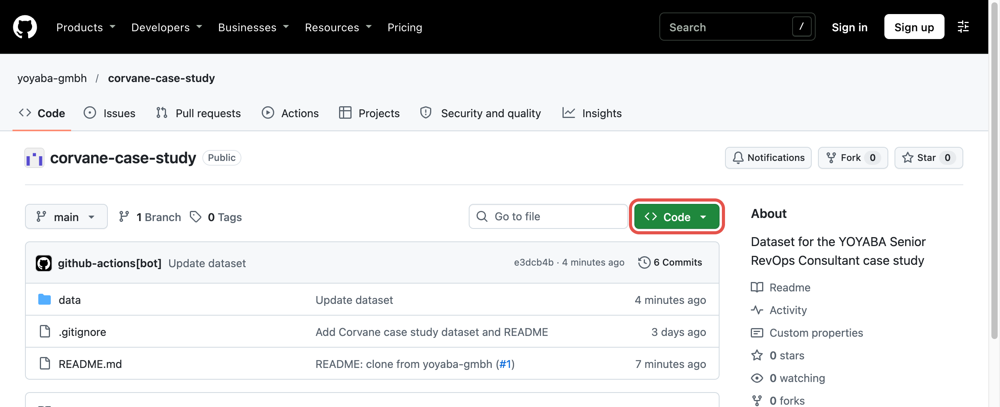
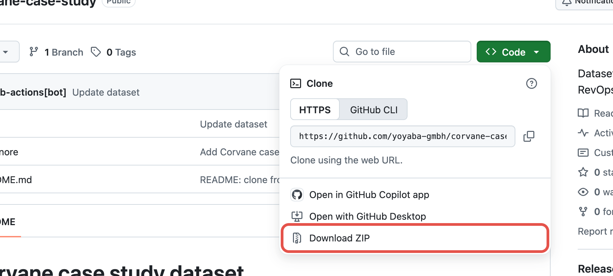

# Corvane case study dataset

This repository holds the data for your YOYABA case study. The questions, the time limit and how to send your answers are in the case study document you received by email. Everything you need to answer them is in the `data/` folder.

Corvane is a fictional company. Every person, number and message in these files was made up for this exercise.

## What is in the repository

```text
data/
├── context/   Documents Anna forwarded: kickoff notes, emails,
│              Slack threads, a handover note and plan summaries
└── *.csv      Exports from Corvane's systems, data to 31 October 2026
```

- `data/context/` is the background. Start with `00_README_from_Jan.md`, Jan's note (Sales Ops) on what each export is and what Jan knows is off.
- Each CSV file name says which system it comes from: HubSpot, Stripe, Gong, Outreach, Google Ads, LinkedIn Ads, Search Console, web analytics, finance, the board reporting dashboard and others.

## Getting the files

The quickest way is this direct link, which downloads everything as one ZIP file:

**[Download the dataset (ZIP)](https://github.com/yoyaba-gmbh/corvane-case-study/archive/refs/heads/main.zip)**

You can also download it from this page. GitHub shows the word **Code** twice: a tab at the top left, and a green button on the right, level with **main** and **Branch**. You need the green button.

1. Click the green **Code** button on the right.

   

2. In the menu that opens, click **Download ZIP** at the bottom.

   

Unzip the file and open the `data/` folder.

If you use git, you can clone the repository instead:

```bash
git clone https://github.com/yoyaba-gmbh/corvane-case-study.git
```
